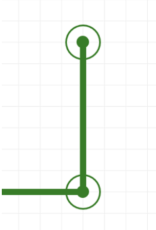
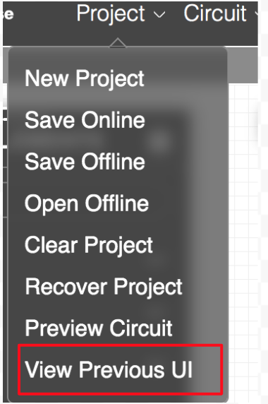

# Verilog support in CircuitVerse

In addition to providing an intuitive graphical interface for designing digital circuits, CircuitVerse supports Verilog—a widely used Hardware Description Language (HDL) for modeling, simulating, and verifying digital hardware systems. CircuitVerse provides two Verilog integration features:

  - [Circuit to Verilog code](#circuit-to-verilog-code)
    - [Steps to Convert Circuit to Verilog Code](#steps-to-convert-circuit-to-verilog-code)
    - [Features and Verilog Constructs Provided by CircuitVerse](#features-and-verilog-constructs-provided-by-circuitverse)
    - [Example](#example)
  - [Verilog code to Circuit](2verilogtocircuit.md)

## Circuit to Verilog code
CircuitVerse allows users to convert graphical circuits into Verilog code and export them for simulation in external environments such as EDA Playground, Icarus Verilog, or ModelSim. The exported Verilog code can also be integrated into hardware synthesis workflows for reconfigurable devices such as FPGAs (using external toolchains like Yosys, Vivado, or Quartus). Note that CircuitVerse generates Verilog source code only; it does not synthesize hardware or generate FPGA bitstreams directly.

## Steps to Convert Circuit to Verilog Code

1. **Design Your Circuit**: Create your digital circuit using the CircuitVerse online simulator. Ensure that your circuit is complete and functions as expected.

2. **Access the Verilog Conversion Tool**:
    - Once your circuit is ready, click on the **"Tools"** menu located at the top of the CircuitVerse interface.
    - Select the **"Export Verilog"** option from the dropdown menu. Refer Figure 8.1.

    

    <div align="center"><em>Figure 8.1</em></div>

3. **Give labels to your input and output elements**:
    - You can give your input, output and elements labels to name them respectively in generated verilog code. This also helps in debugging the code. 

4. **Generate Verilog Code**:
    - A new window will appear displaying the Verilog code and testbench(commented) generated from your circuit.
    - Review the generated code to ensure it accurately represents your circuit design. Refer Figure 8.2.

    

    <div align="center"><em>Figure 8.2</em></div>

    > NOTE: Verilog support is an experimental feature in CV so, in some cases it can generate wrong verilog code.

5. **Download or Copy the Code**:
    - You can either download the Verilog code as a `.v` file or copy the code directly from the window.
    - Use the downloaded or copied code in your preferred Verilog simulator or integrate it into your existing Verilog projects.
    - EDA playground is suggested as simulator to run the generated verilog module (Icarus verilog is the supported version).

6. **Testbench code generated**:
    - The verilog window also contains testbench for the generated verilog module generated but is commented out, it is not filled with the sample values and the user need to enter it manually.

## Features and Verilog Constructs Provided by CircuitVerse
CircuitVerse supports a variety of Verilog constructs for digital design, including:

- **Primitive Logic Gates**: Basic logic gates like AND, OR, NOT, NAND, NOR, XOR, and XNOR are mapped directly to Verilog gate primitives or continuous assignments.
- **Combinational Components**: Multi-bit combinational circuits, such as Multiplexers, Decoders, and Arithmetic Logic Units (ALUs), can be defined and exported using continuous assignments and behavioral logic.
- **Sequential Elements**: State-holding and memory elements like Flip-Flops, Latches, RAM, and ROM are modeled using clock-edge triggered procedural blocks (`always @(posedge clk)`).
- **Structural and Behavioral Modeling**: CircuitVerse primarily produces structural Verilog consisting of module instantiations and wire interconnects, complemented by behavioral procedural blocks where needed for complex elements.
- **Module Instantiations and Subcircuits**: Each subcircuit in CircuitVerse is converted into a separate Verilog module which is then instantiated in the top-level module.

## Example

Here is a simple example of a AND Gate circuit and its corresponding Verilog code:

### Circuit Design

<iframe src="https://circuitverse.org/simulator/embed/andvk?theme=&display_title=false&clock_time=true&fullscreen=true&zoom_in_out=true" style="border-width:; border-style: ; border-color:;" name="myiframe" id="projectPreview" scrolling="no" frameborder="1" marginheight="0px" marginwidth="0px" height="500" width="500" allowFullScreen></iframe>

### Generated Verilog Code

```verilog
module Main(out1, inp1, inp2);
  output out1;
  input inp1, inp2;
  wire and_0_out;
  assign and_0_out = inp1 & inp2;
  assign out1 = and_0_out;
endmodule
```


> TIP: By following these steps, you can efficiently convert your CircuitVerse designs into Verilog code and integrate them into your digital design workflow for further simulation or synthesis. The generated Verilog code can also be targeted to FPGA development boards after synthesis and implementation using appropriate vendor toolchains.

